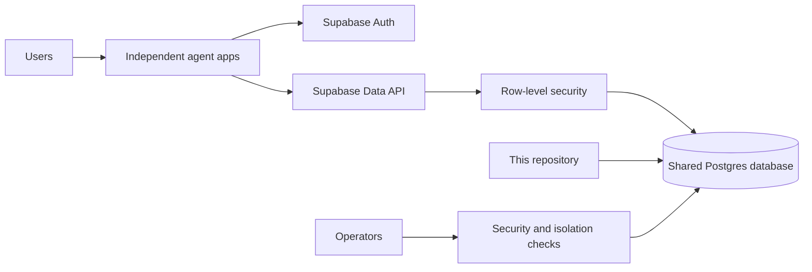

# Agent Suite Platform

## About

This repository holds the shared account and database setup for the agent apps. Each product has its own source repository and deployment, but apps that need a user account or saved data can use the same Supabase project. Keeping the database migrations here gives the team one ordered history to review and apply.

### What it does

- Defines private document storage for Citation Grounded RAG and conversation memory for Persistent Conversation Agent.
- Gives each signed-in user access only to their own rows through database policies.
- Provides scripts for applying migrations and configuring a model provider on Vercel, plus rules for reviewing database permissions.
- Documents how to test two-user isolation before a new data feature goes live.

This is infrastructure, not a user-facing app. The RAG migrations are live; the conversation migration is prepared but still needs to be applied after the database password rotation. No credentials belong in this repository.

## The products

Each product has its own repository and README with setup instructions, an architecture diagram, examples, and operating notes.

| Product | What someone can use it for | Current access |
|---|---|---|
| [Structured Output Agent](https://github.com/kh-bikash/structured-output-agent) | Turn text into validated fields or check existing JSON. | Hosted web app, CLI, local browser |
| [Citation Grounded RAG](https://github.com/kh-bikash/citation-grounded-rag) | Ask questions about private documents and inspect cited quotes. | Hosted web app, CLI, local browser |
| [ReAct Planning Agent](https://github.com/kh-bikash/react-planning-agent) | Answer document questions through a limited sequence of tool calls. | CLI, local browser |
| [Capability Tool Orchestrator](https://github.com/kh-bikash/capability-tool-orchestrator) | Run permitted tools together and handle conflicting results. | CLI, local browser |
| [Persistent Conversation Agent](https://github.com/kh-bikash/persistent-conversation-agent) | Save and recall conversation context across sessions. | CLI, local browser; hosted deployment pending |
| [Human Approval Agent](https://github.com/kh-bikash/human-approval-agent) | Hold actions for human review with a durable audit trail. | CLI, local browser |
| [Cost Aware Agent Router](https://github.com/kh-bikash/cost-aware-agent-router) | Select models within a task budget and review cost decisions. | CLI, local browser |
| [Event Automation Agent](https://github.com/kh-bikash/event-automation-agent) | Process signed webhooks with retries and dead-letter recovery. | Self-hosted service, CLI, operator browser |
| [Multi Agent Debate](https://github.com/kh-bikash/multi-agent-debate) | Compare proposals, critiques, votes, and a synthesis. | Hosted pilot, CLI, local browser |
| [Self Reflective Agent](https://github.com/kh-bikash/self-reflective-agent) | Revise answers against rules and inspect evaluation history. | CLI, local browser |
| [Observable Production Agent](https://github.com/kh-bikash/observable-production-agent) | Run an agent API with metrics, tracing, and canary rollback. | Self-hosted service, CLI, operator browser |
| [Open Agent Patterns](https://github.com/kh-bikash/open-agent-patterns) | Recover from transient endpoint failures and benchmark the pattern. | CLI, local browser, Python library |

## Architecture

Every app verifies the user's Supabase access token before invoking its action. Database calls use that same token, so RLS restricts rows to the signed-in user. The service-role key is reserved for controlled operational checks and never belongs in browser code. The Vercel Supabase integration supplies per-project environment variables; this repository stores no credentials.

## Migrations

The `supabase/migrations/` folder is the source of truth. Add a migration here whenever any app needs a schema change. Use `supabase migration new <description>` to create its file, review the SQL, then run a dry run and apply with `scripts/push_migrations.py`. Provide `DATABASE_URL` through a protected process environment; the script redacts the connection string and password from CLI output. Do not run `db push` from individual app repositories; Supabase migration history is database-wide.

Current migrations:

| Migration | Product | Purpose |
|---|---|---|
| `20261028122542_create_rag_passages` | Citation Grounded RAG | Per-user passages, full-text search, RLS and RPCs. |
| `20261028122836_restrict_rag_grants` | Citation Grounded RAG | Remove broad default grants, including RLS-bypassing `TRUNCATE`. |
| `20261028123835_conversation_messages` | Persistent Conversation Agent | Per-user messages, summaries, recall and quotas. |

## Security rules

- Enable RLS on every exposed table and add ownership predicates using `auth.uid()`.
- Revoke Supabase's broad default grants from `PUBLIC`, `anon`, and `authenticated`; grant only the required operations back to `authenticated`.
- Revoke function execution from `PUBLIC` and `anon`; grant only intended RPCs to `authenticated`.
- Check quotas at the database boundary, including direct Data API writes.
- Test two different users against each new feature to confirm isolation.
- Keep admin credentials out of application runtimes unless an explicitly designed server-only operation needs them.

## Operations

Each app repository has its own deployment and smoke-test notes. Apply database migrations before deploying code that depends on them. After migration, verify table grants, policies, and at least one authenticated read/write path. Backups, monitoring, email delivery, and paid-plan requirements must be reviewed before calling the whole suite production ready.

`scripts/configure_model.py` can provision the same private Groq API key to selected Vercel projects. It reads a local key file, passes the secret via stdin, and configures nonsecret OpenAI-compatible endpoint and model values. Keep the key file outside Git and avoid printing it or passing it as a shell argument. The free model tier is limited; budget and per-user quotas are needed before unrestricted public use.

## Operator guide

### Why the database history is shared

Supabase keeps one migration history for its Postgres database. If each app repository tries to manage that history independently, a new app may be missing earlier migration files and deployment will fail or drift. This repository is the single source of truth for schema changes. The app repositories own their application code, UI, tests, and product-specific smoke tests.

| Change | Put it in |
|---|---|
| New table, index, policy, function, or grant | `supabase/migrations/` here |
| FastAPI route, UI, CLI, or model prompt | The relevant product repository |
| Shared database security check | `scripts/` here |
| User-facing product setup and examples | The product README and deployment guide |

### Release a database-backed feature

1. Add an ordered SQL migration here. Give every exposed table an owner policy and only the grants it needs.
2. Review the SQL against the product's API calls. Check both ordinary user access and whether an anonymous or second user can bypass it.
3. Provide the database URL to the migration script through a protected process environment. Run `python scripts/push_migrations.py --dry-run` and inspect the plan, then run `python scripts/push_migrations.py` to apply it. The script masks the connection string in output.
4. Verify the live grants and policies, then run the product's two-user isolation smoke test from a trusted machine.
5. Deploy the app code that depends on the migration. Check `/healthz`, authentication, the core action, and cleanup before sharing the URL.
6. Record any operational work still needed, such as backups, alert routing, email delivery, or model capacity.

The order matters: an application that calls a new RPC before the migration is live will fail. A schema rollback also needs an explicit reviewed migration; do not delete a migration that has already run.

### Credentials and environments

The publishable Supabase key is used with a user's access token for normal application requests. The service-role key can bypass row policies and belongs only in trusted operator scripts. A database connection URL has even broader access and must never be printed, committed, or placed in a browser bundle. The Vercel integration supplies environment values to connected projects, while product code should read only the values it actually needs.

Model credentials are separate from database credentials. `scripts/configure_model.py` reads a model key from a local file outside Git and sends it to Vercel as a sensitive environment variable. Its command output names configured variables and projects without showing the key. Rotate provider and database credentials when exposure is suspected, then refresh connected application environments and retest.

### Current deployment boundary

Structured Output Agent and Citation Grounded RAG have public Vercel URLs and hosted smoke tests. Multi Agent Debate is a hosted pilot using the same account system but no product database tables. Persistent Conversation Agent has hosted code and a Vercel project, but its conversation migration and live deployment are still pending. The other products remain locally runnable or self-hosted, as listed above. A public URL alone does not establish production capacity, backups, monitoring, or support readiness.

Use the product READMEs for user workflows and the product deployment guides for service-specific checks. Keep this repository focused on shared infrastructure so each product remains independently understandable and maintainable.

### Common issues

| Symptom | Check |
|---|---|
| An app reports a missing RPC | Confirm its required migration was applied here before deploying the app. |
| A user can see another user's data | Stop promotion, review RLS policies and grants, then rerun the two-user isolation test. |
| A migration fails because history differs | Compare the database's migration history with this folder; do not push from a product repository. |
| Model actions fail while storage works | Check the provider key, model permission, and rate limits separately from Supabase. |
| Confirmation email does not arrive | Review Supabase Auth mail settings and delivery capacity before inviting more users. |

When a credential is exposed, rotate it in its owning service, refresh connected environments, redeploy affected apps, and rerun smoke tests. Never paste a new secret into an issue, chat, commit, or command log.
