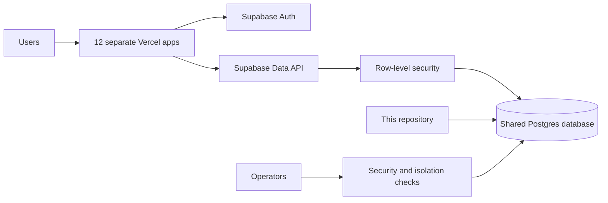

# Agent Suite Platform

Shared Supabase schema and operational checks for the 12 independent agent applications in this workspace. Each application has its own GitHub repository and Vercel URL, while this repository owns the **single ordered migration history** for their shared Supabase project.

## Architecture

Every app verifies the user's Supabase access token before invoking its action. Database calls use that same token, so RLS restricts rows to the signed-in user. The service-role key is reserved for controlled operational checks and never belongs in browser code. The Vercel Supabase integration supplies per-project environment variables; this repository stores no credentials.

## Migrations

The `supabase/migrations/` folder is the source of truth. Add a migration here whenever any app needs a schema change. Use `supabase migration new <description>` to create its file, review the SQL, then run a dry run and apply with `supabase db push --db-url <direct URL>`. Keep the connection URL out of command logs and shell history by passing it from a protected environment through a script. Do not run `db push` from individual app repositories; Supabase migration history is database-wide.

Current migrations:

| Migration | Product | Purpose |
|---|---|---|
| `20261028122542_create_rag_passages` | Citation Grounded RAG | Per-user passages, full-text search, RLS and RPCs. |
| `20261028122836_restrict_rag_grants` | Citation Grounded RAG | Remove broad default grants, including RLS-bypassing `TRUNCATE`. |
| `20261028123835_conversation_messages` | Persistent Conversation Agent | Per-user messages, summaries, recall and quotas. |

## Security rules

- Enable RLS on every exposed table and add ownership predicates using `auth.uid()`.
- Revoke Supabase's broad default grants from `PUBLIC`, `anon`, and `authenticated`; grant only the required operations back to `authenticated`.
- Revoke function execution from `PUBLIC` and `anon`; grant only intended RPCs to `authenticated`.
- Check quotas at the database boundary, including direct Data API writes.
- Test two different users against each new feature to confirm isolation.
- Keep admin credentials out of application runtimes unless an explicitly designed server-only operation needs them.

## Operations

Each app repository has its own deployment and smoke-test notes. Apply database migrations before deploying code that depends on them. After migration, verify table grants, policies, and at least one authenticated read/write path. Backups, monitoring, email delivery, and paid-plan requirements must be reviewed before calling the whole suite production ready.
