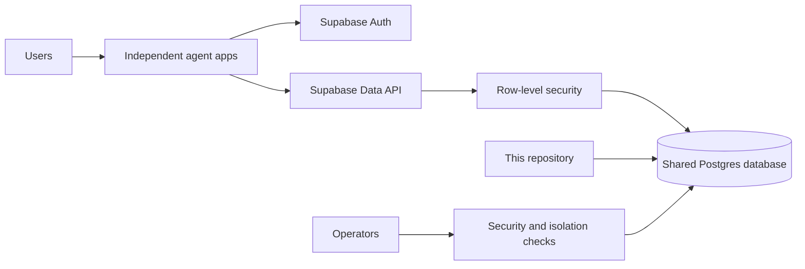

# Agent Suite Platform

## About

This repository holds the shared account and database setup for the agent apps. Each product has its own source repository and deployment, but apps that need a user account or saved data can use the same Supabase project. Keeping the database migrations here gives the team one ordered history to review and apply.

### What it does

- Defines private document storage for Citation Grounded RAG and conversation memory for Persistent Conversation Agent.
- Gives each signed-in user access only to their own rows through database policies.
- Provides scripts for applying migrations, checking permissions, and configuring a model provider on Vercel.
- Documents how to test two-user isolation before a new data feature goes live.

This is infrastructure, not a user-facing app. The RAG migrations are live; the conversation migration is prepared but still needs to be applied after the database password rotation. No credentials belong in this repository.

## The products

Each product has its own repository and README with setup instructions, an architecture diagram, examples, and operating notes.

| Product | What someone can use it for | Current access |
|---|---|---|
| [Structured Output Agent](https://github.com/kh-bikash/structured-output-agent) | Turn text into validated fields or check existing JSON. | Hosted web app, CLI, local browser |
| [Citation Grounded RAG](https://github.com/kh-bikash/citation-grounded-rag) | Ask questions about private documents and inspect cited quotes. | Hosted web app, CLI, local browser |
| [ReAct Planning Agent](https://github.com/kh-bikash/react-planning-agent) | Answer document questions through a limited sequence of tool calls. | CLI, local browser |
| [Capability Tool Orchestrator](https://github.com/kh-bikash/capability-tool-orchestrator) | Run permitted tools together and handle conflicting results. | CLI, local browser |
| [Persistent Conversation Agent](https://github.com/kh-bikash/persistent-conversation-agent) | Save and recall conversation context across sessions. | CLI, local browser; hosted deployment pending |
| [Human Approval Agent](https://github.com/kh-bikash/human-approval-agent) | Hold actions for human review with a durable audit trail. | CLI, local browser |
| [Cost Aware Agent Router](https://github.com/kh-bikash/cost-aware-agent-router) | Select models within a task budget and review cost decisions. | CLI, local browser |
| [Event Automation Agent](https://github.com/kh-bikash/event-automation-agent) | Process signed webhooks with retries and dead-letter recovery. | Self-hosted service, CLI, operator browser |
| [Multi Agent Debate](https://github.com/kh-bikash/multi-agent-debate) | Compare proposals, critiques, votes, and a synthesis. | Hosted pilot, CLI, local browser |
| [Self Reflective Agent](https://github.com/kh-bikash/self-reflective-agent) | Revise answers against rules and inspect evaluation history. | CLI, local browser |
| [Observable Production Agent](https://github.com/kh-bikash/observable-production-agent) | Run an agent API with metrics, tracing, and canary rollback. | Self-hosted service, CLI, operator browser |
| [Open Agent Patterns](https://github.com/kh-bikash/open-agent-patterns) | Recover from transient endpoint failures and benchmark the pattern. | CLI, local browser, Python library |

## Architecture

Every app verifies the user's Supabase access token before invoking its action. Database calls use that same token, so RLS restricts rows to the signed-in user. The service-role key is reserved for controlled operational checks and never belongs in browser code. The Vercel Supabase integration supplies per-project environment variables; this repository stores no credentials.

## Migrations

The `supabase/migrations/` folder is the source of truth. Add a migration here whenever any app needs a schema change. Use `supabase migration new <description>` to create its file, review the SQL, then run a dry run and apply with `scripts/push_migrations.py`. Provide `DATABASE_URL` through a protected process environment; the script redacts the connection string and password from CLI output. Do not run `db push` from individual app repositories; Supabase migration history is database-wide.

Current migrations:

| Migration | Product | Purpose |
|---|---|---|
| `20261028122542_create_rag_passages` | Citation Grounded RAG | Per-user passages, full-text search, RLS and RPCs. |
| `20261028122836_restrict_rag_grants` | Citation Grounded RAG | Remove broad default grants, including RLS-bypassing `TRUNCATE`. |
| `20261028123835_conversation_messages` | Persistent Conversation Agent | Per-user messages, summaries, recall and quotas. |

## Security rules

- Enable RLS on every exposed table and add ownership predicates using `auth.uid()`.
- Revoke Supabase's broad default grants from `PUBLIC`, `anon`, and `authenticated`; grant only the required operations back to `authenticated`.
- Revoke function execution from `PUBLIC` and `anon`; grant only intended RPCs to `authenticated`.
- Check quotas at the database boundary, including direct Data API writes.
- Test two different users against each new feature to confirm isolation.
- Keep admin credentials out of application runtimes unless an explicitly designed server-only operation needs them.

## Operations

Each app repository has its own deployment and smoke-test notes. Apply database migrations before deploying code that depends on them. After migration, verify table grants, policies, and at least one authenticated read/write path. Backups, monitoring, email delivery, and paid-plan requirements must be reviewed before calling the whole suite production ready.

`scripts/configure_model.py` can provision the same private Groq API key to selected Vercel projects. It reads a local key file, passes the secret via stdin, and configures nonsecret OpenAI-compatible endpoint and model values. Keep the key file outside Git and avoid printing it or passing it as a shell argument. The free model tier is limited; budget and per-user quotas are needed before unrestricted public use.
